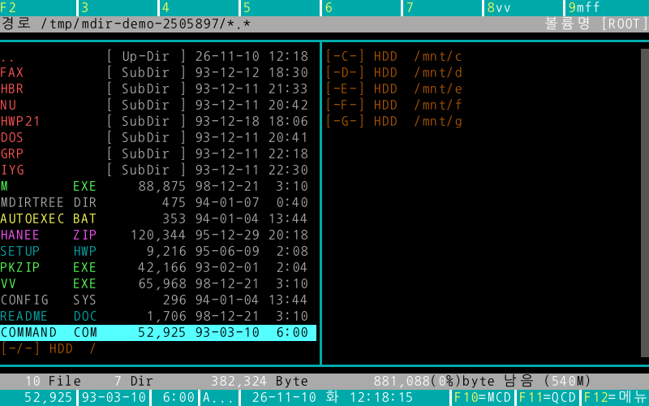
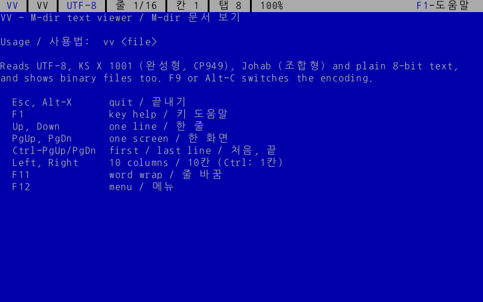
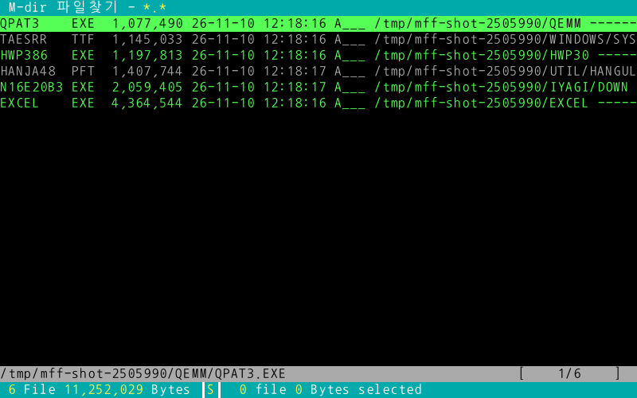
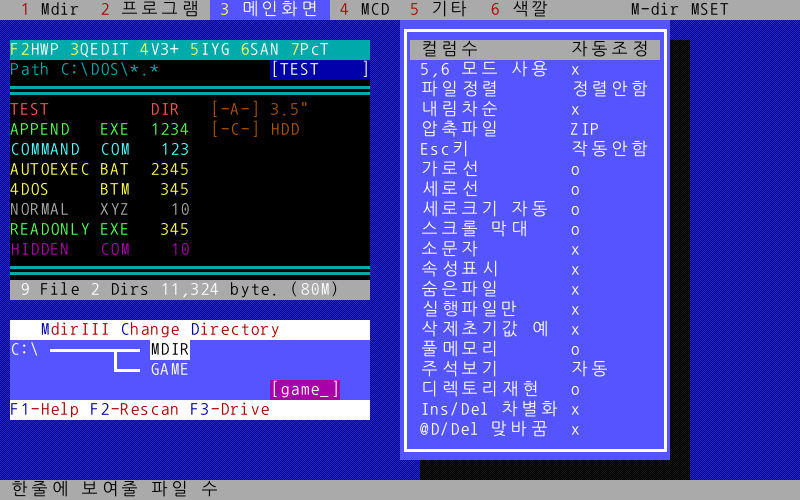
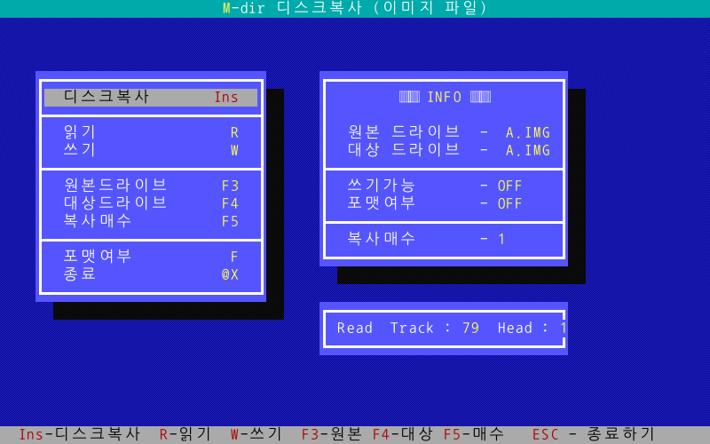

# M-dir

[](https://github.com/Sudo42b/M-dir/releases/latest)
[](https://github.com/Sudo42b/M-dir/releases)
[](#license)

**MdirIII를 기억하시나요? 그 파일 관리자를 지금의 터미널에서 다시 씁니다.**
**The classic Korean DOS file manager, MdirIII, rebuilt in Rust for modern terminals.**

[한국어](#한국어) · [English](#english)



> M-dir is an independent reimplementation. It is not affiliated with MdirIII or its author, and
> contains none of the original files. See [CREDITS.md](CREDITS.md).

---

## 한국어

M-dir은 1990년대 PC 통신 시절 누구나 쓰던 **MdirIII 3.10**의 화면과 키 조작을 그대로 살린
터미널 파일 관리자입니다. Rust와 [ratatui](https://ratatui.rs)로 만들었고 Linux, macOS,
Windows 터미널에서 돌아갑니다.

### 들어 있는 프로그램

| 프로그램 | 원래 이름 | 하는 일 |
|---|---|---|
| `m` | M.EXE | 본체 파일 관리자: 파일 목록, 디렉토리 관리기(MCD), QCD, 풀다운 메뉴, 압축파일 |
| `vv` | VV.EXE | 문서 보기: UTF-8 / 완성형(CP949) / 조합형 자동 인식 |
| `mff` | MFF.EXE | 파일 찾기 |
| `mset` | MSET.EXE | 환경설정 (펑션키, 확장자 연결, 색깔) |
| `mcopy` | MCOPY.EXE | 디스크 복사 (디스크 이미지 `.IMG` 대상) |
| `mf` | MF.EXE | 포맷 (FAT12 플로피 이미지 `.IMG` 만들기) |
| `dscman` | DSCMAN.EXE | 주석 파일(`DESCRIPT.ION`) 정리 |

### 설치

[Releases](https://github.com/Sudo42b/M-dir/releases)에서 Linux·Windows·macOS용 압축 파일을 받아 풀고 `m`(Windows는 `m.exe`)을 실행하면 됩니다. 7개 프로그램이 한 폴더에 들어 있습니다.

직접 빌드하려면 Rust 1.88 이상이 필요합니다.

```sh
git clone https://github.com/Sudo42b/M-dir
cd M-dir
cargo build --release
./target/release/m
```

7개 프로그램이 모두 `target/release/`에 생깁니다. `m`이 `vv`, `mff`, `mset` 등을 같은 폴더에서
찾으므로 한 폴더에 함께 두세요. PATH에 넣으려면:

```sh
cargo install --path .            # m
cargo install --path crates/vv    # vv (다른 도구도 같은 방식)
```

### 주요 키

| 키 | 동작 |
|---|---|
| 글자키 | 빨리찾기 |
| `Enter` | 실행 / 디렉토리 들어가기 |
| `Space` | 선택 |
| `Alt-C` / `Alt-M` / `Alt-D` | 복사 / 이동 / 삭제 |
| `Alt-R` / `Alt-K` | 이름 바꾸기 / 디렉토리 만들기 |
| `Alt-V` | 보기 (vv) |
| `F10` / `F11` | 디렉토리 관리기(MCD) / QCD |
| `F12` | 풀다운 메뉴 |
| `F1` | 전체 키 도움말 |
| `Alt-X` | 끝내기 |

마우스: 클릭으로 막대 이동, 더블클릭으로 실행·들어가기, 휠로 스크롤, 펑션키 줄·`F10`/`F11`/`F12`·메뉴·대화상자 클릭. 끄려면 MSET에서 마우스사용을 끕니다.

### 설정

- 설정 파일: `~/.config/mdir/M.CFG` (Windows: `%APPDATA%\mdir\M.CFG`, `M_CFG` 환경변수로 바꿀 수 있음)
- 메시지는 한글이 기본입니다. 영어로 보려면 `MDIR_LANG=en`.

### 원본과 다른 점

- 플로피 드라이브가 없으므로 디스크 복사·포맷은 디스크 이미지 파일을 다룹니다.
- 마우스는 모든 도구에서 쓸 수 있습니다: m(파일 목록·MCD 트리·펑션키 줄·메뉴), vv 상태 줄, mset 메뉴·목록·색깔표, mff 파일 목록, mf·mcopy 명령 메뉴와 상태 줄, 모든 대화상자.
- Alt·Ctrl만 누르고 있을 때 나오는 키 안내 줄은 보통 터미널에서는 나오지 않습니다.
- ZIP은 내장 기능으로 다루고, 다른 압축 형식은 해당 압축 프로그램이 설치되어 있어야 합니다.
- 옛 `M.CFG`(이진 형식)는 읽지 못하고, 설정은 텍스트 형식으로 저장합니다.
- 일부 값(선택 파일 색, Esc 기본 동작 등)은 추정값이며 [MECHANICS.md](MECHANICS.md)에 표시되어 있습니다.

### 기여

이슈와 PR 환영합니다. 먼저 [AGENTS.md](AGENTS.md)를 읽어 주세요(구조, 규칙, 검증 방법). 원본 화면과 다른 부분을 발견하면 DOSBox 등에서 찍은 원본 화면과 함께
이슈로 알려 주세요. 단, 원본 프로그램 파일이나 문서 자체는 올리지 말아 주세요.

---

## English

M-dir brings back **MdirIII 3.10**, the file manager every Korean PC user knew in the 1990s, with
its screen layout and keys, as a terminal program written in Rust with
[ratatui](https://ratatui.rs). It runs in Linux, macOS and Windows terminals.

### Programs

| Program | Original | What it does |
|---|---|---|
| `m` | M.EXE | Main file manager: file list, directory manager (MCD), QCD, pull-down menus, archives |
| `vv` | VV.EXE | Text viewer: auto-detects UTF-8 / KS (CP949) / Johab |
| `mff` | MFF.EXE | Find files |
| `mset` | MSET.EXE | Settings (function keys, extension commands, colours) |
| `mcopy` | MCOPY.EXE | Disk copy (works on `.IMG` disk images) |
| `mf` | MF.EXE | Format (creates FAT12 floppy `.IMG` images) |
| `dscman` | DSCMAN.EXE | Cleans `DESCRIPT.ION` description files |

### Install

Download the archive for Linux, Windows or macOS from [Releases](https://github.com/Sudo42b/M-dir/releases), unpack it and run `m` (`m.exe` on Windows). All seven programs are in one folder.

To build it yourself you need Rust 1.88 or newer.

```sh
git clone https://github.com/Sudo42b/M-dir
cd M-dir
cargo build --release
MDIR_LANG=en ./target/release/m
```

All seven programs end up in `target/release/`. Keep them in one folder: `m` looks for `vv`,
`mff`, `mset` and the others beside itself.

### Keys

| Key | Action |
|---|---|
| Letter keys | speed search |
| `Enter` | run / enter directory |
| `Space` | tag |
| `Alt-C` / `Alt-M` / `Alt-D` | copy / move / delete |
| `Alt-R` / `Alt-K` | rename / make directory |
| `Alt-V` | view (vv) |
| `F10` / `F11` | directory manager (MCD) / QCD |
| `F12` | pull-down menu |
| `F1` | full key help |
| `Alt-X` | quit |

Mouse: click moves the bar, double click runs or enters, the wheel scrolls; the function-key line, `F10`/`F11`/`F12`, menus and dialogs are clickable. Turn it off with MSET's Mouse option.

### Settings

- Config file: `~/.config/mdir/M.CFG` (Windows: `%APPDATA%\mdir\M.CFG`; override with `M_CFG`).
- Messages are Korean by default; set `MDIR_LANG=en` for English.

### Differences from the original

- No floppy drives today, so disk copy and format work on disk image files.
- The mouse works in every tool: m (file list, MCD tree, function-key line, menus), vv's status line, mset's menus, lists and colour picker, mff's file list, mf and mcopy's command menu and status line, and every dialog.
- The key hint line shown while holding Alt or Ctrl doesn't appear in most terminals.
- ZIP is built in; other archive formats need their archiver installed.
- The old binary `M.CFG` can't be read; settings are saved as text.
- A few values (tagged-file colour, default Esc action, …) are estimates, marked in
  [MECHANICS.md](MECHANICS.md).

### Contributing

Issues and pull requests are welcome. Start with [AGENTS.md](AGENTS.md) (layout, rules, how to verify). If something looks different from the original, open an
issue with a screenshot of the original (for example from DOSBox). Please don't upload the original
program files or manuals.

---

## Screenshots

| | |
|---|---|
|  |  |
|  |  |

## License

Licensed under either of [MIT](LICENSE-MIT) or [Apache-2.0](LICENSE-APACHE) at your option.
